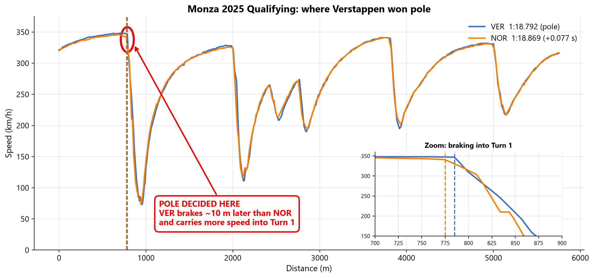
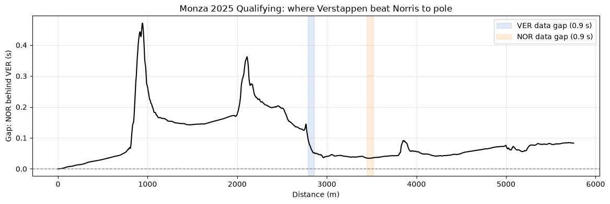

# One Lap: telemetry analysis of the 0.077 s pole margin at Monza

Max Verstappen took pole position from Lando Norris by 0.077 s in Q3 at the 2025 Italian Grand Prix. This project uses public telemetry to identify where on the lap that margin was gained, and assesses how far the data can support the conclusion.

**[Watch the interactive ghost car replay](https://its-srd.github.io/assets/projects/one-lap/monza-pole-animation.html)** | **[Read the analysis notebook](notebooks/monza_pole_analysis.ipynb)** | **[Project page](https://its-srd.github.io/projects/one-lap.html)**



## Results

- The method reproduces the official 0.077 s gap to within 0.006 s.
- Verstappen gained about 0.07 s on the main straight, then braked about 10 m later into the Rettifilo chicane (785 m against 775 m), leading by about 0.15 s by Turn 2.
- Norris recovered most of that deficit through Roggia and the Lesmos, by braking earlier and getting on the throttle sooner.

## Method

1. Load the fastest Q3 lap of each driver through [tif1](https://pypi.org/project/tif1/), a TracingInsights cache of F1 timing data.
2. Interpolate both laps onto 2,000 common distance points and compute the time gap.
3. Compare speed, throttle and brake traces through the corners where the gap changes.
4. Align both laps on a common time base to build the replay.

## Data quality



- Telemetry is sampled at about 7 to 8 Hz, so braking points are accurate to roughly 10 m.
- The brake channel is on or off only, so braking pressure cannot be compared.
- Each lap contains one 0.9 s data dropout (Verstappen at about 2,820 m, Norris at about 3,480 m). These regions are treated as low confidence.
- A single lap per driver cannot separate driving from lap to lap variation. Comparing three laps each, and accounting for tyre age and track evolution, would strengthen the conclusions.

## Run it

Requires Python 3.13.

```
python -m venv .venv
.venv\Scripts\activate
pip install -r requirements.txt
python make_animation.py
```

This downloads the telemetry and writes `monza_pole_animation.html`. On macOS or Linux, activate with `source .venv/bin/activate`. The notebook is in `notebooks/` and runs in Jupyter or VS Code.

## Repository contents

| Path | Contents |
|---|---|
| `notebooks/monza_pole_analysis.ipynb` | The full analysis, with plots |
| `make_animation.py` | Builds the replay from the telemetry |
| `animation_template.html` | Page template for the replay |
| `monza_pole_animation.html` | The built replay |
| `images/` | Figures used in this README |

## Author

Soham Dhage, MSc Computational Fluid Dynamics, Cranfield University. [Portfolio](https://its-srd.github.io) | [LinkedIn](https://linkedin.com/in/soham-dhage)

This is an independent personal project and is not affiliated with Formula 1 or any team. Timing data belongs to its respective owners.
